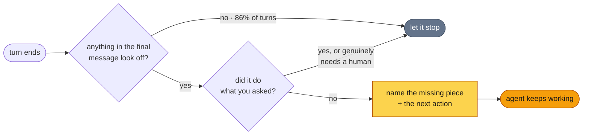

<p align="center">
  
</p>

<h1 align="center">flipback</h1>

<p align="center">
  <em>An automatic <code>/goal</code> for every turn.</em>
</p>

<p align="center">
  <a href="https://github.com/fainir/flipback/actions/workflows/ci.yml"></a>
  <a href="LICENSE"></a>
</p>

<p align="center">
  <a href="#install"><strong>Install</strong></a> ·
  <a href="#flipback-and-goal">vs /goal</a> ·
  <a href="#measured-on-real-sessions">Measured</a> ·
  <a href="#how-it-decides">How it decides</a> ·
  <a href="#faq">FAQ</a>
</p>

---

flipback is a Claude Code plugin that does what `/goal` does without you typing a goal: when a
turn ends before the work you asked for is done, it sends the agent back to finish. It reads your
request from the conversation, stays silent on almost every turn, and costs nothing on the turns
that look fine.

## The problem

Ask for three things. Get one, and a message that sounds like all three:

```
> Add a slugify() helper to src/text.ts, write tests for it, and update
  the README with an example.

  Added slugify() to src/text.ts. It lowercases, strips punctuation and
  collapses whitespace into hyphens.

  Let me now write the tests and update the README.
                                                            [turn ends]
```

Nothing there is false. There are also no tests and no README example, and nobody is going to
write them, because the turn is over. With flipback installed, the turn does not end. The agent
gets this back and keeps going:

```
  ┌─ flipback ─────────────────────────────────────────────────────┐
  │ The request had three parts and you did one. Your last message │
  │ announced the rest, but no tool calls followed. Write the      │
  │ tests for slugify(), then add the README example.              │
  └────────────────────────────────────────────────────────────────┘
```

## flipback and `/goal`

Claude Code's [`/goal`](https://code.claude.com/docs/en/goal) keeps an agent working until a
condition you write holds: after every turn, a small model checks your condition and starts
another turn if it is not met. It is the right tool for a big job with a checkable finish line.

Most turns never get a goal, though. You ask for something, the agent stops early, and you only
notice later. flipback covers those turns.

| | `/goal` | flipback |
|---|---|---|
| Setup | Type a condition, every session | Install once; on in every session |
| Checks against | The condition you wrote | Your latest request, read from the conversation |
| Model calls | One after every turn while the goal is active | Only when a free local check finds something off: about 1 turn in 7 |
| Keeps the agent going | Until the condition is met or judged impossible | One nudge per turn, then the agent may stop |
| Best for | A large job with a verifiable end state | Everyday requests where nobody set a goal |

Use both. They do not fight: flipback never nudges a turn that another stop hook (`/goal`
included) has already sent back.

## Measured on real sessions

We replayed a month of the author's own interactive Claude Code sessions, **823 turn endings
from 262 sessions**, through flipback's actual transcript reader and local check. Every turn the
check flagged went to the judge prompt on Claude Haiku, and a second model (Claude Opus 5.5) then
read each request and final message to decide whether the work really was unfinished.

- **86% of turns never reached a model.** The free local check let them stop. The other 14% made
  one Haiku call each.
- **flipback sent the agent back on 36 turns (4.4%), and was right on 30 of them (83%).** Turns it
  caught ended like this:
  - "Now let me verify the rest of the screens render correctly, then publish." *(turn ends)*
  - "The port-4000 server never started (the session ended first). Starting it again:" *(turn ends)*
  - "Should I retry that check now?" *(it had the build and the emulator)*
- **The 6 wrong nudges** were real blockers: a token only the person could paste, a preference
  only they could choose, a status run that had already logged everything. Every nudge tells the
  agent it may say so in one line and stop, so a wrong nudge costs one short reply.
- **It is tuned to stay quiet, so it misses some.** In a random 50 of the turns the local check
  let through, 6 were also unfinished, mostly ones whose last message did not announce the next
  step ("The offer stands: I can open App Store Connect..."). For a job that must finish, set a
  `/goal`.

Limits of this measurement: one person's sessions, and heavily autonomous ones; the labels come
from a model, not a human study; turns still waiting on background work (a subagent, a monitor)
were left out, as flipback does live.

## Install

In a Claude Code session:

```
/plugin marketplace add fainir/flipback
/plugin install flipback@flipback
```

Or from your shell:

```bash
claude plugin marketplace add fainir/flipback
claude plugin install flipback@flipback
```

You need **Node.js 18 or newer** and the **`claude` CLI** on your `PATH`: the hook runs on
`node`, and the judge is `claude -p` on the sign-in you already have. No API key, no config, no
dependencies.

To try it for one session without installing:

```bash
git clone https://github.com/fainir/flipback
claude --plugin-dir ./flipback
```

## What it catches

| The turn ends looking like | It actually is |
|---|---|
| A summary covering everything you asked for | Three of five parts done |
| "Now let me run the tests." | The tests were never run |
| "I cannot verify this renders correctly." | It has a browser and never opened it |
| **"Next steps for you: 1... 2... 3..."** | **The work, rewritten as your homework** |
| A clear, accurate report of a build error | Stopping at a solvable problem |
| A finished function | A `TODO` and a hardcoded return |
| "Would you like me to continue?" | A question asked into an empty room |

Each one reads as diligence, which is why they survive a skim.

**One action, never a list.** An agent that finishes 80% of a job and hands back "sign in here,
upload that, then post this" has returned the work to you as chores. If the agent has the tools,
the task is the agent's. Being genuinely blocked buys it **one** ask, prepared up to the act only
a person can do:

> **Caught:** "You'll need to sign in to GitHub, then upload the image in Settings."
>
> **Allowed:** *(opens the login page)* "The GitHub login page is open. Sign in and I'll take it
> from there."

## What it leaves alone

It stays quiet when the work is done and checked, when you asked a question rather than for a
job, when you said stop, when a subagent or a scheduled wakeup is still due to bring the agent
back, and when the agent needs an approval, a credential, a payment or a decision that is yours.
A specific, investigated blocker ends the turn. Not having looked yet does not.

## How it decides



When the Stop hook fires, `hooks/flipback.mjs` reads the end of the transcript (the last 2 MB):
your latest request, the tools used since, and the agent's final message. Then:

1. **It lets the agent stop, with no model call,** if flipback is disabled, if the agent is
   already continuing because a stop hook blocked it, if a subagent or scheduled wakeup is due
   back, if there is no request to measure against, if the final message is under 40 characters
   and nothing failed, or if you just said stop.
2. **A free local check** looks for signs of an early stop: the last tool call failed; the final
   message announces work ("let me now run...", "I'll update..."); it asks you something ("would
   you like...", "should I..."); it mentions a TODO, a placeholder, "not implemented", "for now"
   or "out of scope"; it has unchecked `- [ ]` boxes; or files were edited and nothing was run.
   No match, and the agent stops.
3. **Only then a small model judges.** flipback runs `claude -p --model haiku` with your request
   (first 4,000 characters), the names of the tools used, and the final message (last 6,000
   characters). The judge has no tools, no MCP servers and no hooks, and its session is not saved.
4. **Only a clear "incomplete" blocks.** The hook exits 2 with the judge's message, which Claude
   Code hands to the agent. Anything else (complete, no answer, a timeout) lets the agent stop.

## It will not trap your agent

- **One nudge per turn.** It never blocks a turn that a stop hook already sent back, and Claude
  Code caps consecutive stop-hook continuations on its own.
- **The agent can disagree.** Every nudge ends with an out: if the work is done, or it needs
  something only a person can give, it says which in one line and ends the turn.
- **Every failure exits quietly.** Judge unreachable, timed out, transcript unreadable: your agent
  stops exactly as it would without flipback.

## Configuration

None needed. Three environment variables change it:

| Variable | Default | Effect |
|---|---|---|
| `FLIPBACK_DISABLED` | unset | `1` turns the hook off without uninstalling |
| `FLIPBACK_MODEL` | `haiku` | Model for the judge; anything `claude --model` accepts, such as `sonnet` |
| `FLIPBACK_TIMEOUT_MS` | `90000` | Give up on the judge after this long and let the agent stop |

Set them in the shell you start Claude Code from, or in the `env` block of your settings:

```json
{
  "env": { "FLIPBACK_MODEL": "sonnet" }
}
```

Claude Code stops the hook after 180 seconds (`timeout` in `hooks/hooks.json`), so a
`FLIPBACK_TIMEOUT_MS` above that has no effect.

## Cost

- **Most turns cost nothing:** steps 1 and 2 are local string checks (86% of turns in the
  measurement above).
- **A flagged turn costs one Haiku call** through your own `claude` CLI, billed like the rest of
  your Claude Code usage. Your request is cut to 4,000 characters and the final message to 6,000.
- **Latency** on those turns is the startup of `claude` plus one response, never more than
  `FLIPBACK_TIMEOUT_MS`.

## Turn it off

```bash
FLIPBACK_DISABLED=1 claude                      # one session
claude plugin disable flipback@flipback         # until you enable it again
claude plugin uninstall flipback@flipback       # for good
```

## FAQ

**Why not just use `/goal`?**
Do, for big jobs. `/goal` needs a condition each session and checks it with a model after every
turn. flipback needs nothing, works out what "done" means from your request, and calls a model on
about one turn in seven. They cover different turns and work together.

**Can it loop forever?**
No. Claude Code sets `stop_hook_active` when the agent is continuing because a stop hook blocked
it, and flipback never blocks in that state. The most it adds to a turn is one round.

**What does the judge see, and where does it go?**
Your latest request, the names of the tools the agent used, and its final message. Not file
contents, tool inputs or tool output. It goes through your own `claude` CLI to the provider your
session already uses.

**It never seems to fire.**
Most turns should not reach the judge, so silence is normal. If it never fires at all:

- Check `node --version` is 18 or newer and that `claude` is on the `PATH` Claude Code runs hooks
  with. Without `claude`, the judge cannot start and flipback stays quiet by design.
- If the judge cannot authenticate, flipback stays quiet. In long Claude desktop app sessions,
  the sign-in a hook inherits can expire while the session itself keeps working; a new session
  starts with a fresh one.
- Run `claude --debug` to see each hook run in `~/.claude/debug/<session-id>.txt`.

**Does it judge subagents?**
No. It runs on `Stop`, the main agent's turn ending, not on `SubagentStop`.

**Windows?**
Untested. The judge starts without a shell, so it needs a `claude` executable Node can find
directly (the native installer's `claude.exe`). With only an npm `claude.cmd`, flipback stays
quiet.

**What does the skill do?**
`skills/flipback/SKILL.md` teaches the agent to catch its own early stops first: count the parts
of the request, verify instead of assuming, never hand back a to-do list, and ask for at most one
action when genuinely blocked. Claude loads it when it is about to stop with work unverified, or
right after a nudge. You can also run it as `/flipback:flipback`.

## Development

No dependencies to install.

```bash
git clone https://github.com/fainir/flipback && cd flipback
npm test                    # node --test: unit tests plus the hook run end to end
claude plugin validate .    # checks the plugin and marketplace manifests
```

The tests never call a model: `test/fixtures/bin/claude` stands in for `claude -p`, and the
end-to-end tests run the exact command from `hooks/hooks.json` with that stub first on `PATH`.
You can run the hook by hand the same way:

```console
$ echo "{\"transcript_path\": \"$PWD/test/fixtures/incomplete.jsonl\"}" \
    | PATH="$PWD/test/fixtures/bin:$PATH" \
      FAKE_CLAUDE_REPLY='{"complete": false, "message": "Write the tests for slugify(), then add the README example."}' \
      node hooks/flipback.mjs; echo "exit $?"
Write the tests for slugify(), then add the README example.

If this is wrong - the work really is done, or you need authority, a secret, or a decision only a person can make - say which in one line and end your turn.
exit 2
```

```
hooks/hooks.json          registers the Stop hook
hooks/flipback.mjs        reads the turn, judges it, nudges or stays quiet
skills/flipback/SKILL.md  teaches the agent to catch its own early stops
test/                     node:test suites, fixture transcripts, the stub judge
```

## License

[MIT](LICENSE)

---

### More open source by [Nir Feinstein](https://nirfeinste.in)

- [agent-harness](https://github.com/fainir/agent-harness) - make Claude Code or Codex act as a product team, a CEO or a portfolio manager
- [frugal](https://github.com/fainir/frugal) - your agent finds the cheaper honest way before it pays for anything
- [recall](https://github.com/fainir/recall) - your Claude Code memory in every agent, over MCP
- [most-capable-agent-system-prompt](https://github.com/fainir/most-capable-agent-system-prompt) - the copy-paste prompt for a self-improving agent system
- [All projects](https://nirfeinste.in/#open-source)
