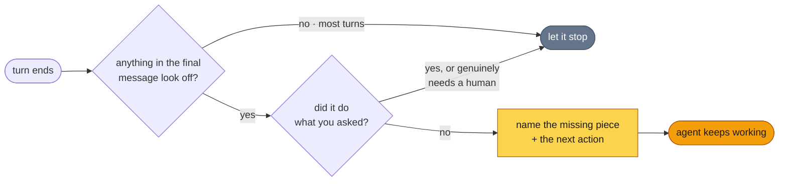

<p align="center">
  
</p>

<h1 align="center">flipback</h1>

<p align="center">
  <em>Your agent stopped. It could have kept going.</em>
</p>

<p align="center">
  <a href="#install"><strong>Install</strong></a> ·
  <a href="#what-it-catches">What it catches</a> ·
  <a href="#what-it-leaves-alone">What it leaves alone</a> ·
  <a href="#it-will-not-trap-your-agent">Safety</a>
</p>

---

## The problem

Ask for five things. Get three, and a summary that describes five.

The agent is not lying to you. It finished the *sentence* about the work, and from the inside
that feels almost exactly like finishing the work. Read the last message on its own and it sounds
like a job well done:

```
> Add a slugify() helper to src/text.ts, write tests for it, and update
  the README with an example.

  Added slugify() to src/text.ts. It lowercases, strips punctuation and
  collapses whitespace into hyphens.

  Let me now write the tests and update the README.
                                                            [turn ends]
```

Nothing there is false. There are also no tests and no README example, and nobody is going to
write them, because the turn is over.

That is the whole failure. Not capability - the agent had the tools, the file open, and your
request as permission. It simply stopped, because stopping always feels like the safe option.

**flipback is the thing that notices.**

```
  ┌─ flipback ─────────────────────────────────────────────────────┐
  │ The request had three parts and you did one. Your last message │
  │ announced the rest, but no tool calls followed. Write the      │
  │ tests for slugify(), then add the README example.              │
  └────────────────────────────────────────────────────────────────┘

  [the agent picks it back up and writes the tests]
```

## How it works

Your agent ends a turn. flipback reads the conversation, compares what you asked for against what
actually happened, and either stays quiet or hands back the one specific thing left undone.



The first check is a handful of local patterns. No model, no network, no cost, and it settles the
large majority of turns. Only a turn that already looks unfinished is worth a second opinion, and
only then does a small model read the conversation.

## Install

```
/plugin marketplace add fainir/flipback
/plugin install flipback
```

No API key, no config, no build step. It runs on the Claude Code auth you already have.

## What it catches

| The turn ends looking like | It actually is |
|---|---|
| A summary covering everything you asked for | Three of five parts done |
| "Now let me run the tests." | The tests were never run |
| "I cannot verify this renders correctly." | It has a browser and never opened it |
| A clear, accurate report of a build error | Stopping at a solvable problem |
| A finished function | A `TODO` and a hardcoded return |
| "Would you like me to continue?" | A question asked into an empty room |
| "The frontend felt out of scope" | Scope you never agreed to cut |

The common thread: each one reads as diligence. That is exactly why they survive a skim, and why
something other than you should be reading for them.

That third row is worth dwelling on. Agents routinely hand work back as unverifiable while
holding the tools to verify it - they can start the server, drive the browser, fill the form, and
screenshot the result. The skill's job is largely to remind them of what they are already holding.

## What it leaves alone

A nagging linter gets uninstalled in a week, so flipback is built to be just as willing to say
nothing. It stays quiet when the work is done and checked, when you asked a question rather than
for a job, when you told it to stop, and when the agent genuinely needs an approval, a
credential, or a decision that is yours to make.

That last one matters, and the distinction is sharper than it sounds. Compare:

> *"Blocked: the billing dashboard redirects to a login needing your password and a 2FA code. I
> opened it in the browser to confirm."* → **let through.** A specific blocker, already investigated.

> *"I cannot verify the page renders, please run it yourself."* → **caught.** It had a browser.

A sign-in, a payment, an irreversible action, or something only you know: those end the turn.
Not having looked yet does not.

## It will not trap your agent

The failure mode worth fearing here is not a missed nudge. It is a hook that will not let a
session end. Three things prevent it:

- **One nudge per turn.** It never fires twice in a row. Not a heuristic, a hard rule.
- **The agent can disagree.** Say the work is done, or name what only a person can give, and that
  is taken as an answer.
- **Every failure exits quietly.** Model unreachable, timed out, transcript unreadable: your agent
  stops exactly as it would have without this installed.

Off switch, no uninstall needed:

```bash
export FLIPBACK_DISABLED=1
```

## What is in here

```
hooks/flipback.mjs        reads the turn, judges it, nudges or stays quiet
skills/flipback/SKILL.md  teaches the agent to catch its own early stops
```

Two files that matter. No dependencies, no build, no npm package. The hook is the enforcement;
the skill is the part that makes it rarely necessary, by giving the agent a way to recognise a
bad stop before anything has to catch it.

## Settings

| | |
|---|---|
| `FLIPBACK_DISABLED=1` | turn it off without uninstalling |
| `FLIPBACK_MODEL` | judge model, default `haiku` |
| `FLIPBACK_TIMEOUT_MS` | give up and stay quiet after this, default `90000` |

## License

MIT
